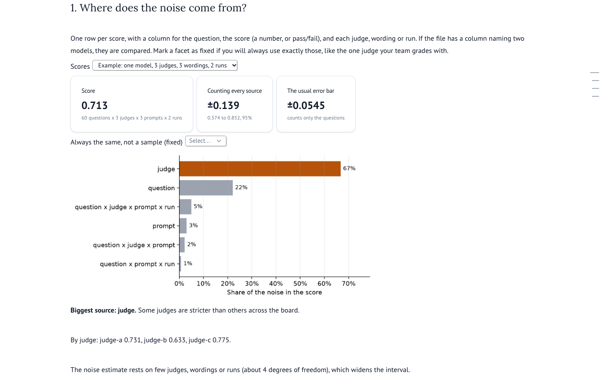

# evalnoise

**Where does the noise in my eval score come from?** Split it across questions, judges, prompt wordings and reruns, get an error bar that counts all of them, and see where your next API calls do the most good. With a [calculator that runs in your browser](https://ai-with-md.github.io/evalnoise/).

[](https://pypi.org/project/evalnoise/)
[](https://github.com/ai-with-md/evalnoise/actions/workflows/tests.yml)


[](https://ai-with-md.github.io/evalnoise/)

An eval score moves when you change the questions. It also moves when you swap the judge, reword the prompt, or simply run it again. The usual error bar, even the careful kind that groups scores by question, only counts the first of these. So a "+3 points" win can turn out to be one judge's taste, and a score can shift by more than its error bar when someone reruns the eval with a different grader.

evalnoise takes a small pilot, where every question is scored under every judge, wording and run, and works out how much each source adds. Then it answers the practical question: with the next $50 of API calls, should you add questions, judges, wordings or reruns?

## The number most people get wrong

Simulated evals where the true score is known: 50 to 80 questions, each answered under 2 or 3 prompt wordings, 2 runs each, and graded by 3 judges. Judges and wordings differ a little, as they do in practice. 1,000 simulated evals per row.

| | Usual interval (grouped by question) | evalnoise |
|---|---|---|
| Covers the true score (95% promised) | 74% | 94% |
| The same, for pass/fail verdicts | 72% | 96% |
| Two equally good models, judges that lean one way or the other: calls the difference real (5% promised) | 37% | 4.9% |
| Two models 6 points apart, no leaning judges: finds the difference | 99% | 96% |
| No judge or wording noise at all: covers the true score | 95% | 95%, about the same width |

When judges and wordings don't matter, evalnoise gives the same answer as the usual interval. When they do, it says so, and says by how much.

## Try it

**In the browser:** [ai-with-md.github.io/evalnoise](https://ai-with-md.github.io/evalnoise/). Upload a pilot or try the examples, nothing to install.

**In Python:**

```bash
pip install evalnoise
```

No dependencies. Python 3.9 or later.

## Use

### 1. Run a small pilot

Score every question under every combination you want to learn about: every judge, every prompt wording, every run. For example 60 questions x 3 judges x 3 wordings x 2 runs. Keep one row per score:

```text
question_id,judge,prompt,run,verdict
q001,judge-a,wording-1,1,pass
q001,judge-b,wording-1,1,fail
...
```

Scores can be numbers (0 to 1, 1 to 5, anything), true/false, or words like pass and fail. Use at least 3 judges and 3 wordings if you can: with only 2, how much they differ is little more than a guess (see [Limits](#limits)).

### 2. Where does the noise come from?

```python
import evalnoise as en

pilot = en.read_scores("examples/pilot.csv")
print(pilot.report())
# Read 1,080 rows: question from 'question_id', score from 'verdict', judge from 'judge', prompt from 'prompt', run from 'run'.

result = pilot.study()
print(result.report())
```

```text
Score 0.713 from 60 questions x 3 judges x 3 prompts x 2 runs (1,080 scores).
  Interval counting every source of noise (95%): 0.574 to 0.852 (+-0.139).
  The usual interval, counting only which questions were picked: 0.658 to 0.768 (+-0.0545).
  The noise estimate itself rests on few judges, wordings or runs (about 4 degrees of freedom), which widens the interval. More of them in the pilot would firm it up.
Where the noise in this score comes from:
  judge                              67%  some judges are stricter than others across the board
  question                           22%  some questions are harder than others
  question x judge x prompt x run     5%  everything else, including one-off noise in single scores
  prompt                              3%  some prompt wordings score higher across the board
  question x judge x prompt           2%  an interaction between question, judge and prompt
  question x prompt x run             1%  answers change from run to run
  By judge: judge-a 0.731, judge-b 0.633, judge-c 0.775
```

Two thirds of the uncertainty is which judge you happened to pick: judge-b passes 63% of answers, judge-c passes 78%. Adding questions will not fix that.

Everything in the report is also available as attributes: `result.mean`, `result.se`, `result.naive_se`, `result.interval()`, and `result.components`, each with its `variance` and `share`.

### 3. What would another design give?

```python
print(result.project(items=500, judges=1))
# 500 questions x 1 judge x 3 prompts x 2 runs: the score would be good to about +-0.142 (95%).
print(result.project(items=200, judges=3, prompts=3, runs=1))
# 200 questions x 3 judges x 3 prompts x 1 run: the score would be good to about +-0.0884 (95%).
```

500 questions with one judge are no better than the pilot. 200 questions with three judges and a single run cost less and do much better.

### 4. Where should the next calls go?

Give the price of a call to the model you are testing and a call to the judge, and either a budget or a target:

```python
print(result.plan(budget=40, generation_cost=0.01, judge_cost=0.004, limits={"judge": 3}))
```

```text
Best design for $40.00: 454 questions, 3 judges, 4 prompts, 1 run.
  1,816 model calls and 5,448 judge calls, costing $39.95.
  The score would be good to about +-0.0843 (95%).
  On the same basis, the pilot's own design ($7.92 at these prices) gives about +-0.0985.
```

```python
print(result.plan(target=0.1, generation_cost=0.01, judge_cost=0.004, limits={"judge": 3}))
```

```text
Best design for +-0.1: 140 questions, 3 judges, 1 prompt, 1 run.
  140 model calls and 420 judge calls, costing $3.08.
  The score would be good to about +-0.0999 (95%).
  On the same basis, the pilot's own design ($7.92 at these prices) gives about +-0.0985.
  Careful: the pilot had only 3 prompts, so how much prompts differ is a rough estimate; dropping to 1 is a bet that it stays small.
```

`limits` caps how many judges, wordings or runs to consider (only three judges are available here); `max_items` caps the questions when your eval set has a fixed size.

### 5. Comparing two models or prompts

Score both on the same questions, judges, wordings and runs, with a column naming the model:

```python
two = en.read_scores("examples/two_models.csv")
print(two.compare().report())  # or compare(new="candidate", old="baseline")
```

```text
Difference, candidate minus baseline: +0.18 from 80 questions x 4 judges x 2 runs (640 paired scores).
  Interval counting every source of noise (95%): -0.118 to 0.477 (+-0.297).
  The usual interval, counting only which questions were picked: 0.0472 to 0.312 (+-0.132).
  The usual interval would call this a real difference, but with the judge, wording and run noise counted it could be noise.
  The noise estimate itself rests on few judges, wordings or runs (about 5 degrees of freedom), which widens the interval. More of them in the pilot would firm it up.
Where the noise in this difference comes from:
  judge                     68%  judges disagree about which version is better overall (for example, a judge that favours one model's style)
  question                  17%  the new version is better on some questions and worse on others
  question x run             8%  answers change from run to run
  question x judge x run     6%  everything else, including one-off noise in single scores
  By judge: judge-a +0.0438, judge-b +0.0688, judge-c +0.481, judge-d +0.125
```

Most of the "win" comes from judge-c. Three of the four judges see a gap of 0.04 to 0.13 points on a 1 to 5 scale.

Comparisons are kinder than single scores: a judge that is strict with both models cancels out. What is left is noise in the gap itself, like a judge that prefers one model's style. Runs are paired by their label, so run 1 of one model is compared with run 1 of the other.

### Judges you will always use

The analysis treats judges and wordings as a sample from all the ones you might have used, so the score generalizes beyond them. If you will always grade with exactly these judges, mark them fixed and their own leniency becomes part of what you are measuring:

```python
print(pilot.study(fixed=["judge"]).report())
# Interval counting every source of noise (95%): 0.653 to 0.773 (+-0.0598).
```

### Runs are nested

Run 1 of one question has nothing to do with run 1 of another, so runs are analysed as nested within each question and wording. Columns named run, seed, sample, attempt, trial and similar are treated this way. If run 1 really is the same for every question (all run-1 answers came from one batch on one day), pass `nested=[]`.

### Rows in memory

```python
rows = [
    {"item": "q1", "judge": "a", "prompt": "p1", "score": 1},
    {"item": "q1", "judge": "b", "prompt": "p1", "score": 0},
    ...
]
result = en.study(rows)                                   # every column other than item and score is a facet
result = en.study(df, item="question", score="correct")   # a pandas DataFrame works too
diff = en.compare(rows, system="model", new="v2", old="v1")
```

### Reading your files

`read_scores` reads CSV, JSON (a list of objects) and JSON Lines, with one row per score. It finds the question, score and system columns by common names (`question_id`, `item`, `id`; `score`, `verdict`, `passed`, `correct`; `model`, `system`, `version`) and treats columns named like judges, graders, prompts, templates, runs and seeds as facets. Nested JSON fields are named with dots, like `metadata.judge`. Columns that look like text or ids are left out and reported. Check `table.report()` the first time, and name columns yourself when the guess is wrong:

```python
table = en.read_scores("results.jsonl", item="example_id", score="judge_score", facets=["grader", "seed"])
```

Questions with any missing score are left out of the analysis and listed in the report.

## Command line

```bash
evalnoise check   examples/pilot.csv
evalnoise check   examples/two_models.csv                 # two systems in the file: compares them
evalnoise check   examples/two_models.csv --only baseline # or analyse one of them
evalnoise check   results.jsonl --fixed judge -v
evalnoise project examples/pilot.csv items=500 judges=1
evalnoise plan    examples/pilot.csv --budget 40 --model-cost 0.01 --judge-cost 0.004 --limit judge=3
evalnoise plan    examples/pilot.csv --target 0.05 --model-cost 0.01 --judge-cost 0.004 --max-items 800
```

Use `--item`, `--score`, `--facets`, `--system`, `--new` and `--old` when the automatic guess is wrong, and `-v` to see which columns were used.

## How the numbers are checked

The test suite simulates evals from a known model, where questions, judges, wordings and runs each add their own noise, and checks each promise:

| Promise | Held in simulation |
|---|---|
| The interval covers the true score (95% promised) | 94% (usual interval: 74%) |
| The same for pass/fail verdicts | 96% |
| Comparing equal models with leaning judges: false "real difference" (5% promised) | 4.9% (usual interval: 37%) |
| Comparing models 6 points apart: finds the difference | 96% |
| With no judge or wording noise, the interval is no wider than needed | 95% coverage, about the same width as the usual interval |
| The judge spread is estimated without bias | yes, on average |
| A projection predicts the spread of scores at the new design | within 10% |
| The plan from a pilot beats spending the same money on the pilot's design | yes |

The two-way analysis is also checked against the textbook formulas, and run labels can be shuffled within each question without changing anything. See [`tests/test_simulation.py`](https://github.com/ai-with-md/evalnoise/blob/main/tests/test_simulation.py).

## How it compares

- **Error bars grouped by question**, as in [Adding Error Bars to Evals](https://arxiv.org/abs/2411.00640) and Inspect's clustered standard errors, are what evalnoise calls the usual interval. They are right when the judge and wording are fixed for good. evalnoise adds the noise from judges, wordings and reruns, and tells you which of them matters.
- **[Total Evaluation Error](https://arxiv.org/abs/2604.11581)** (Messing, NeurIPS 2026) makes the same argument for LLM pipelines and finds usual error bars 53 to 70% too narrow. evalnoise is a small Python implementation of the idea for balanced pilots.
- **[aiEvalR](https://cran.r-project.org/package=aiEvalR)** brings generalizability theory to AI evaluation in R. evalnoise does it in Python with no dependencies, plus budget planning with API prices.
- **Judge bias correction** with human labels ([judgy](https://github.com/ai-evals-course/judgy), [evalstats](https://github.com/ianarawjo/evalstats)) answers a different question: whether the judge agrees with people. evalnoise asks how much the score depends on which judge, wording and run you used.
- **[evalsize](https://github.com/ai-with-md/evalsize)** tells you how many questions you need for a pass rate. evalnoise tells you whether more questions are even the right fix.

## Limits

- **Balanced pilots only.** Every question must be scored under every combination of judges, wordings and runs. Questions with gaps are left out. Unbalanced designs need a mixed model fitted by REML, which this package does not do.
- **Few judges or wordings give rough answers.** The spread between judges is estimated from the judges you used. With 2, it is close to a guess: in simulation, when judges differ a lot, the interval covered 86% with 2 judges and 91% with 4, against 95% promised. The interval widens to reflect this, and the report says so, but use 3 or more of each when you can.
- **The plan treats the pilot's estimates as exact.** When a pilot had only a few judges or wordings, a plan that drops to fewer of them comes with a warning.
- **Judges and wordings are treated as a sample** from all the ones you might have used, unless you mark them fixed. Decide which one you mean: "this model with this judge" or "this model, judged fairly".
- **Effects are assumed to add up.** For pass/fail verdicts this works well for the average and the interval (see the simulations above), but the components describe pass rates, not anything deeper.
- **Projections and plans** use a normal approximation for the interval, so they are a little optimistic for pilots with very few judges or wordings.

## Methods

evalnoise runs a generalizability study (G-study) and a decision study (D-study), the standard tools of generalizability theory:

- Variance components come from the expected mean squares of a balanced random-effects analysis of variance, with questions crossed with every facet and runs nested within question and wording. Negative estimates are set to zero.
- The error variance of the overall score adds each component divided by the number of levels it is averaged over. Components of fixed facets alone drop out.
- The interval uses a t distribution with Satterthwaite degrees of freedom, so it widens when the estimate rests on few judges or wordings.
- Projections and plans reuse the same formula at other sample sizes. Plans search every allowed combination of judges, wordings and runs and pick the number of questions that fits the budget or the target.

References: Cronbach, Gleser, Nanda and Rajaratnam, *The Dependability of Behavioral Measurements* (1972); Brennan, *Generalizability Theory* (2001); Satterthwaite, "An approximate distribution of estimates of variance components" (1946); Messing, "Hidden Measurement Error in LLM Pipelines" ([arXiv 2604.11581](https://arxiv.org/abs/2604.11581)).

## More tools

Small, free tools for building and checking AI systems:

- **[evalsize](https://github.com/ai-with-md/evalsize)**: how many eval examples you need before a difference between prompts or models means anything.
- **[costplan](https://github.com/ai-with-md/costplan)**: what an AI agent will cost and what budget cap to set, from a handful of pilot runs.
- **[sturdytools](https://github.com/ai-with-md/sturdytools)**: retries, timeouts, rate limits and circuit breakers for the tools an AI agent calls.

## Development

```bash
python -m venv .venv
source .venv/bin/activate
pip install -e ".[dev]"
pytest
```

The calculator is a [marimo](https://marimo.io) notebook in [`app/calculator.py`](https://github.com/ai-with-md/evalnoise/blob/main/app/calculator.py), published to GitHub Pages as a WebAssembly app on every push to `main`.

## License

MIT
